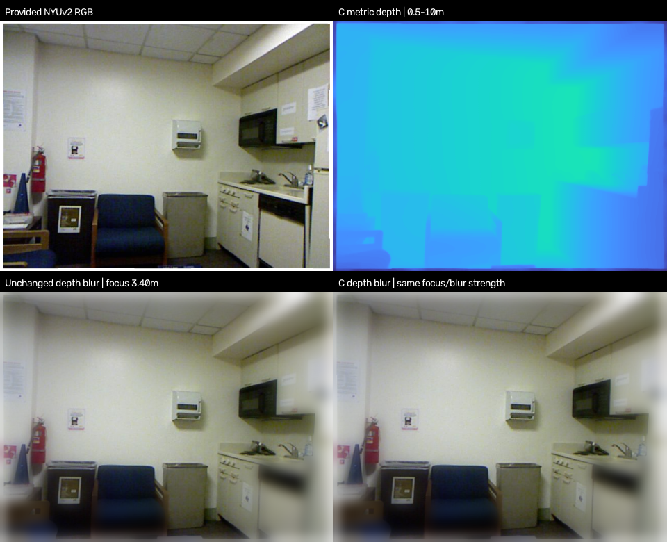

# Monocular Metric Depth Estimation & Video Consistency

AIAA 3201 Project 3: classical stereo, pretrained monocular/video depth,
reliability-gated temporal fusion, evaluation and metric measurement demo.

The implementation follows the assignment and [PLAN.md](PLAN.md).
[Reading notes](docs/related_work_notes.md) and the original assignment PDF
are retained as background.
Actual runnable commands and limitations are documented below and in the
[implementation guide](docs/implementation.md).

## Current status

The required Middlebury quarter-resolution and NYUv2 labeled datasets and model
weights are downloaded and verified locally. Full stereo experiments and both
654-image metric-depth GPU baselines are evaluated. C is the main Part 3
exploration; C_cuda provides equivalent GPU processing, with A as a temporal
supplement. Self-recorded clips and extra datasets are optional extensions.
The rollercoaster relative-video comparison, provided-image application, three
difficult cases and non-report delivery ZIP are prepared. The official clip has
70 genuine frames although the brief requests 100; this exception still needs
course confirmation. The academic report is paused at the user's request.

- [Non-report delivery, media and reproduction](docs/course_delivery.md)
- [Project status and remaining items](docs/project_status.md)
- [Current assignment compliance and the clip-length discrepancy](docs/new_brief_compliance.md)
- [Benchmark results and reproduction](docs/benchmark_results.md)
- [Part 3 results and direction selection](docs/part3_results.md)
- [Part 3 B: frozen development-set global scale calibration](docs/global_scale_study.md)
- [Step 5: Part 3 inputs, reproduction, ablations and limitations](docs/step5.md)
- [Local Part 1/2 integration notes](docs/team_integration.md)
- [Assignment requirements](docs/course_overview.md)
- [Complete saved-video replay bundle](artifacts/relative_video_demo/README.md)

Tests: 113 passed with CUDA; final CPU recheck: 112 passed, 1 CUDA-only skipped. Dataset/weight hashes and source versions are recorded in
`data/manifests/`. Large datasets and weights stay local.

## Quick start (PowerShell, from repository root)

```powershell
. ./scripts/project_cache.ps1
conda activate depth-project
python scripts/check_environment.py
python -m pytest -q
```

If Conda is not on PATH, invoke your environment's `python.exe` directly.
The integrated core requires NumPy, OpenCV, Pillow, SciPy, Matplotlib, PyYAML and h5py; [requirements.txt](requirements.txt)
is supplied for a new environment. Model-specific dependency instructions are
in [checkpoints/README.md](checkpoints/README.md). Python 3.11 is recommended
for official model stacks. `depth-project` above is an example environment name;
replace it with the name of your configured environment.
Tests additionally need pytest (`requirements-test.txt`). Model-specific dependency configurations remain in `environment*.yml` and `requirements-core.txt` /
`requirements-unidepth.txt`; those are not CPU bootstrap instructions.

Every output path must be new. Use another run ID when repeating a command.

## Part 1: geometry and framewise baseline

双目实验与调参入口：`pipelines.part1.run_middlebury`、
`pipelines.part1.tune_middlebury`，配置及已有结果见 [docs/step1.md](docs/step1.md)。

入口与代码归属：[pipelines/part1/README.md](pipelines/part1/README.md)。
双目核心在 `src/geometry.py`、`src/stereo/run_baseline.py`；逐帧基线使用 `src/models/foundation.py` 的 DAV2 分支。

```powershell
python -m pipelines.part1.run_stereo --input data/MiddEval3/trainingQ --output outputs/part1/sgbm --method sgbm
python -m pipelines.part1.run_stereo --input data/MiddEval3/trainingQ --output outputs/part1/bm --method bm
python -m pipelines.part1.run_framewise_depth --input data/videos/static.mp4 --repo third_party/Depth-Anything-V2 --checkpoint checkpoints/depth_anything_v2_vits.pth --output outputs/part1/dav2_static --fps 10 --max-side 640 --vis-min 0 --vis-max 50
```

Middlebury input must already be rectified. The stereo runner exports disparity,
invalid masks, coverage, matched-pixel errors, full-mask bad-pixel rates and
disparity-perturbation sensitivity CSVs. Its baseline is converted from mm to m;
the depth formula includes the principal-point offset `doffs`.

## Part 2: native metric and video models

NYUv2 基准入口：`pipelines.part2.run_depth_pro_nyuv2`、
`pipelines.part2.run_unidepth_v2_nyuv2`、`pipelines.part2.run_key_analysis`。
其已完成实验采用独立冻结协议，详见 [docs/step3.md](docs/step3.md)，不混入公共小样本结果。

入口与代码归属：[pipelines/part2/README.md](pipelines/part2/README.md)。
模型适配在 `src/models/foundation.py` 的 Depth Pro/VDA 分支，推理流程共用 `src/infer.py`。

First create/validate a manifest using [data instructions](data/README.md).
Paths in manifests are relative to the manifest, not the current directory.

```powershell
python -m src.prepare_data validate --manifest data/nyuv2/manifest.json
python -m pipelines.part2.run_metric_depth --input data/nyuv2/manifest.json --repo third_party/ml-depth-pro --checkpoint checkpoints/depth_pro.pt --output outputs/part2/depthpro_nyu --vis-min 0.1 --vis-max 10
python -m src.evaluate --run outputs/part2/depthpro_nyu --manifest data/nyuv2/manifest.json
python -m pipelines.part2.run_video_depth --input data/videos/static.mp4 --repo third_party/Video-Depth-Anything --checkpoint checkpoints/video_depth_anything_vits.pth --output outputs/part2/vda_static --fps 10 --max-side 640 --vis-min 0 --vis-max 50
python -m pipelines.part2.run_video_depth --input data/videos/static.mp4 --metric --repo third_party/Video-Depth-Anything --checkpoint checkpoints/metric_video_depth_anything_vits.pth --output outputs/part2/metric_static --fps 10 --max-side 640 --vis-min 0.1 --vis-max 10
python -m src.evaluate_video --run outputs/part2/metric_static --static-roi 20 80 20 120
```

Select the static ROI manually on your own clip. DAV2 and relative VDA store raw
relative inverse-depth-like values; their `arbitrary` visualization range must
be chosen once and shared across the comparison. Native metric evaluation
rejects ground-truth alignment. KITTI uses the same evaluator with its own
manifest, crop, valid mask and max depth. No official protocol is guessed.

## Part 3: edge-aware refinement and controlled ablations

入口与代码归属：[pipelines/part3/README.md](pipelines/part3/README.md)。
正式主线 C 在 `src/exploration/edge_aware.py`，完整输入、输出和复现见
[Step 5](docs/step5.md)。时序融合在 `src/temporal.py`、`src/flow.py`，作为扩展保留。

```powershell
python -m pipelines.part3.refine_nyuv2 --run outputs/full_benchmark_20261029/depth_pro_nyuv2 --output outputs/part3/depth_pro_C_reproduce_v1 --check-only
python -m pipelines.part3.refine_nyuv2 --run outputs/full_benchmark_20261029/depth_pro_nyuv2 --output outputs/part3/depth_pro_C_reproduce_v1 --backend cuda --save-predictions
```

以下为可选时序扩展入口，需要 Part 2 的米制视频预测：

```powershell
python -m pipelines.part3.run_temporal_fusion --run outputs/part2/metric_static --output outputs/part3/static_A6
python -m pipelines.part3.run_ablation --run outputs/part2/metric_static --output outputs/part3/static_ablations --static-roi 20 80 20 120
python -m pipelines.part3.run_demo --run outputs/part3/static_A6 --intrinsics configs/intrinsics.example.json --output outputs/part3/demo --interactive
python -m pipelines.part3.compare_directions --run outputs/part2/metric_static --output outputs/part3/directions
```

Replace example intrinsics with calibration at the **saved image resolution**.
Depth Pro runs can use their predicted focal length if calibration is absent.
The application exports a PLY point cloud and an RGB/depth/measurement panel.
Pass measured click annotations with `--clicks` to get application MAE.

方向 B（独立尺度标定）、C（边缘滤波）、D（不确定性平滑）、E（低分辨率光流加速）、
F（带滞回预警）及 B+C+D 组合代码均保留在 `src/exploration/`。
具体入口、标定限制和 CPU 合成对照命令见 [Part 3 说明](pipelines/part3/README.md)。
没有独立标定数据时 B 自动跳过；没有真实 Part 2 预测时不声称完成真实视频效果比较。

For GPU inference later, add `--device cuda --fp16` to model commands. RAFT
requires a local torchvision-compatible checkpoint. See the guide for an
independent-flow evaluation cross-check and packaging commands.

## Repository layout

```text
pipelines/part1/ stereo and framewise baseline entry points + code map
pipelines/part2/ metric and video model entry points + code map
pipelines/part3/ temporal fusion, ablation and demo entry points + code map
src/           shared geometry, flow, models, metrics, CLI pipelines and demo
configs/       explicit dataset, camera, measurement and submission examples
scripts/       environment check
tests/         numerical, geometry, flow, fusion and end-to-end CPU tests
docs/          reading notes, implementation guide and papers
data/          local data (ignored except README)
checkpoints/   local weights (ignored except README)
third_party/   official model clones (ignored)
outputs/       immutable prediction runs and evaluation outputs (ignored)
```

`src/io.py`, `src/metrics/video_project.py`, `src/visualization/video.py`, `src/evaluate.py` and
`src/evaluate_video.py` are shared infrastructure for all three Parts. Existing
`python -m src.*` commands remain supported; `pipelines.part*` makes the assignment
ownership explicit without maintaining duplicate implementations.

Both teams' APIs now share packages: `src/models/foundation.py` preserves video
adapters, `src/metrics/video_project.py` preserves the video/Part 3 evaluator,
`src/visualization/video.py` preserves fixed-range rendering, and
`src/stereo/run_baseline.py` preserves the simple baseline CLI. Teammate frozen
image metrics and official SI boundary metric remain separate named functions.
Existing `python -m src.stereo` and `from src.models import DepthModel` still work.

## References and licenses

The [reading notes](docs/related_work_notes.md) and original assignment PDF
list the required papers and datasets.
Model APIs follow the official [Depth Anything V2](https://github.com/DepthAnything/Depth-Anything-V2),
[Depth Pro](https://github.com/apple/ml-depth-pro) and
[Video Depth Anything](https://github.com/DepthAnything/Video-Depth-Anything)
implementations. RAFT uses [torchvision](https://docs.pytorch.org/vision/stable/models/raft.html).
Third-party source and weights retain their own licenses and are not bundled.
Original project code is covered by [LICENSE](LICENSE).

## Representative provided-image application



The course archive is local and includes private self-recorded previews; it is not
committed to the public repository. See the delivery guide for source-length
limitations, raw arrays, CPU replay, failure cases and checksum verification.
